<p align="center">
  <a href="https://furkiozknn.github.io/peri-golf/">
    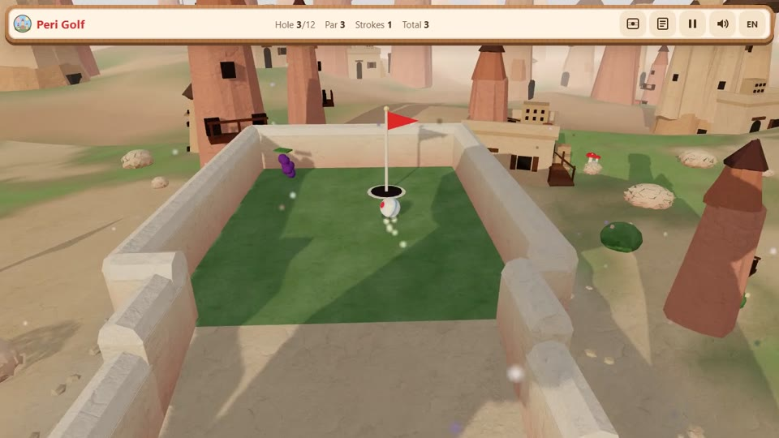
  </a>
</p>

<p align="center">
  <a href="https://furkiozknn.github.io/peri-golf/"></a>
</p>

<p align="center">
  
  
  <a href="LICENSE"></a>
  
</p>

<!-- portals:start -->
<p align="center">
  Also on: <a href="https://furkiozknn.itch.io/peri-golf"><strong>itch.io</strong></a>
</p>
<!-- portals:end -->

<p align="center">
  <strong>A 3D physics mini-golf game set among the fairy chimneys of Cappadocia: 12 hand-designed holes past cave houses, a pottery wheel, a donkey crossing and a sunrise rim with hot-air balloons overhead.</strong>
</p>

<!-- gameplay gif -->

<p align="center">
  <sub>Watch the promo: <a href="https://github.com/Furkiozknn/social-videos/releases/download/promo-2026-10/2026-10-27-peri-golf-en.mp4">EN</a> &middot; <a href="https://github.com/Furkiozknn/social-videos/releases/download/promo-2026-10/2026-10-27-peri-golf-tr.mp4">TR</a></sub>
</p>

## Features

- **Twelve holes, par 40:** From Pigeon Terrace to Sunrise Ridge across terraces between fairy chimneys, cave houses, an underground-city tunnel, a pottery workshop, a vineyard road, a stone bridge, and a pigeon valley.
- **Dynamic diorama hazards:** A turning pottery wheel, a rolling stone door, swinging lanterns, and a donkey crossing the path all push the ball with real slope, bump, ramp, and wall-bounce physics across grass, sand, and stone.
- **Three stars per hole:** Finish under par, find the hidden grape, and land the hole's trick shot (a hole-in-one, a bank off a wall, a long putt) guided by a ghost line showing your best shot.
- **Autonomous bot verification:** The `?auto` bot uses the same physics as a player and finishes all 12 holes in 14 strokes (par 40) with 20 stars and 0 errors, with or without the optional CC0 assets (measured 2026-11-09). The bot takes the hidden shortcut on 8 of the 12 holes, so its score is much lower than a typical first round.
- **Ultra-lean web performance:** A single `index.html` running Three.js r170 delivering 60 fps at 16–22 draw calls on an Intel UHD 620 at 1280x720 on High tier (60 fps at 26 draw calls on phone Low tier).

## How to play

> [!TIP]
> **Goal:** Sink the ball on all 12 holes in as few strokes as you can. The course par is 40; holes unlock one by one.

1. **Aim and charge:** Press on the ball and drag back, or use `Left` / `Right` arrows and hold `Space` to charge. The white line previews the shot up to the first bounce.
2. **Release to strike:** Release the drag or `Space` to shoot the ball. Ball velocity scales with drag distance or charge duration.
3. **Survey and orbit:** Drag on empty ground to orbit the camera, scroll the wheel or use `Up` / `Down` arrows to zoom, and tap the eye button (or `V`) for a top-down overview.

<details>
<summary><b>Rules and hazards</b></summary>

- **Hazards:** Water hazards and falls off the course cost one stroke and return the ball to its prior spot.
- **Moving obstacles:** The turning pottery wheel, rolling stone door, swinging lanterns, and walking donkey actively push the ball.
- **Challenge stars & scorecard:** Each hole features par and three challenge stars (under par, hidden grape, trick shot). Press the scorecard button or `C` to inspect progress against par.
- **Ghost line:** A ghost line shows your best completion on each hole.

</details>

### Controls

| Action | Mouse / touch | Keyboard |
|---|---|---|
| Aim and shoot | press on the ball, drag back, release | `Left` / `Right` aim, hold `Space` to charge, release to shoot |
| Orbit the camera | drag on empty ground | |
| Zoom | wheel | `Up` / `Down` |
| Top-down overview | eye button | `V` |
| Scorecard | scorecard button | `C` |
| Pause menu | pause button | `P` / `Esc` |
| Music / effects / language | settings | `M` / `X` / `L` |

- **Global hotkeys:** `P` / `Esc` pause, `M` music, `X` effects, `L` language.
- **Persistence:** Settings (master, music and effects volume, TR / EN, Low / High quality) are saved in `localStorage` under `arena.periGolf.settings`; the run under `arena.periGolf.save`; best scorecard, unlocks, hole records, and ghost lines under `arena.periGolf.best`. The language follows the browser; phones start on the Low tier.

<details>
<summary><b>URL flags for testing</b></summary>

| Flag | Effect |
|---|---|
| `?auto` | A bot plays the whole course with the same physics as a player |
| `?debug` | FPS, draw calls, triangles, GPU name and JS errors on screen; `window.periGolfSim(seconds)` and `window.periGolfDebug` |
| `?sim=N` | Fast-forward N seconds of simulation before the first frame |
| `?low` | Shadows off, pixel ratio 1, half the particles |
| `?noassets` | Skip the optional assets in `assets/` and play the procedural version |
| `?lang=en` / `?lang=tr` | Start language |
| `?hole=N` | Start a run at hole N (1–12) |
| `?nosave` | Do not write to `localStorage` |

`window.periGolf` exposes the live state.

</details>

## Screenshots

<table>
  <tr>
    <td width="33%">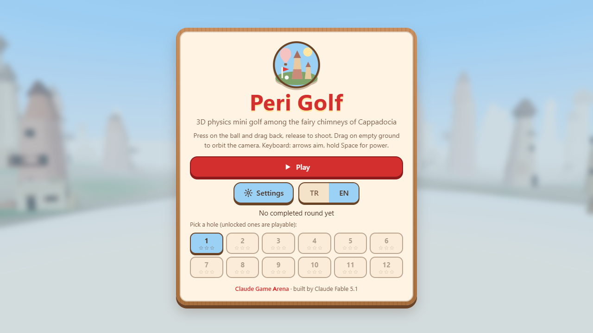<br><sub>Title screen</sub></td>
    <td width="33%">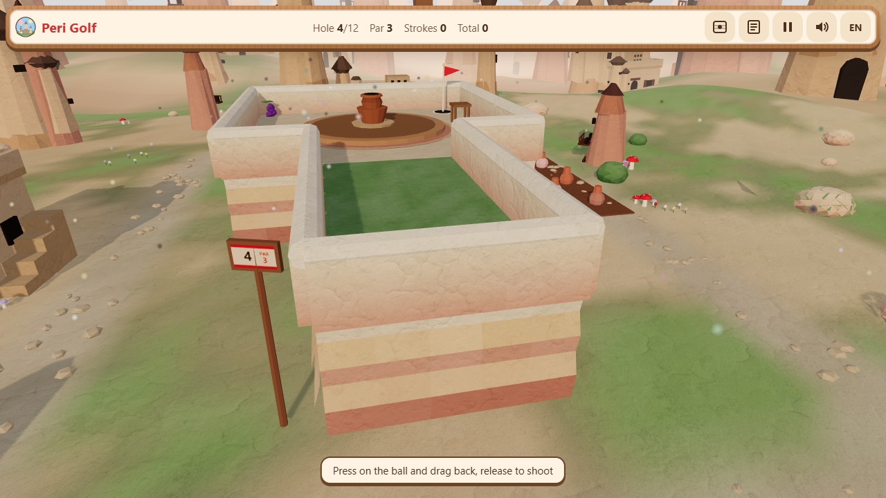<br><sub>Hole 4: Pottery Workshop</sub></td>
    <td width="33%">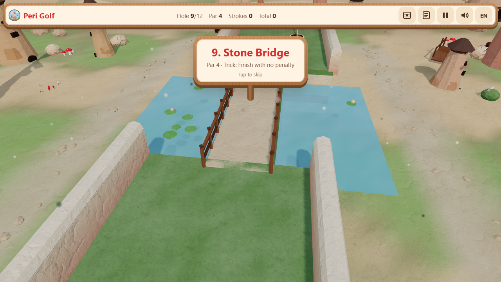<br><sub>Hole 9: Stone Bridge, intro flyover</sub></td>
  </tr>
  <tr>
    <td width="33%">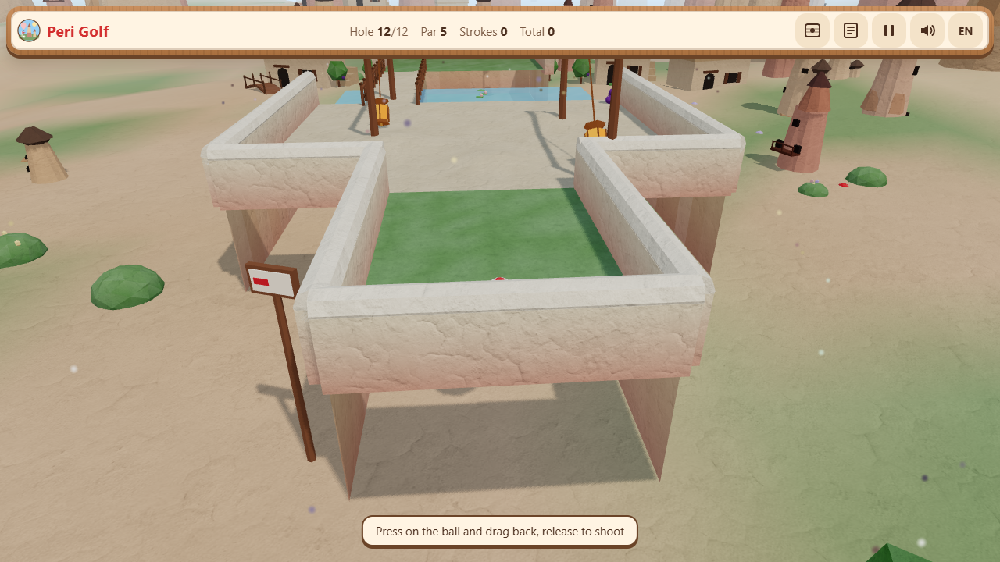<br><sub>Hole 12: Sunrise Ridge</sub></td>
    <td width="33%">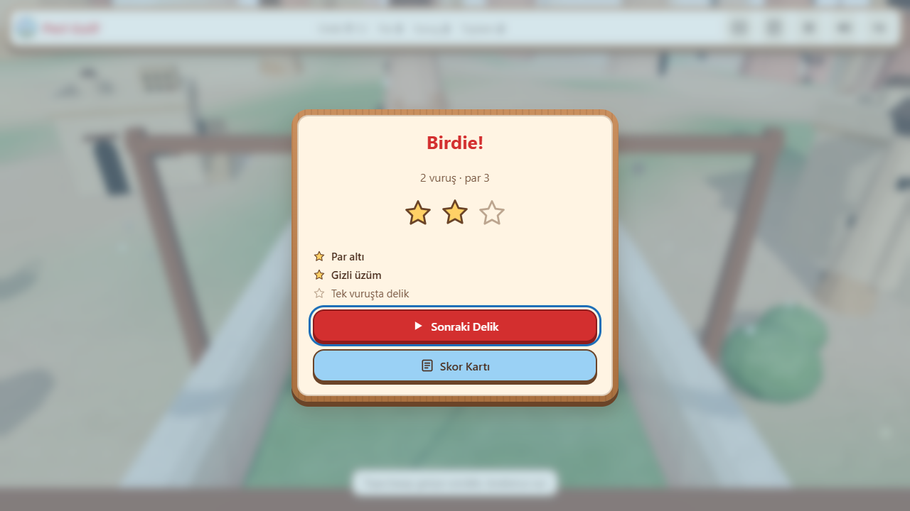<br><sub>Birdie (Turkish UI)</sub></td>
    <td width="33%">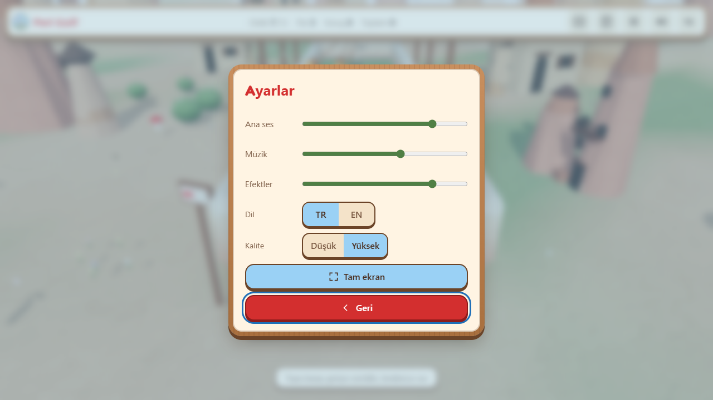<br><sub>Settings</sub></td>
  </tr>
</table>

<details>
<summary><b>Phone layout and asset pass comparisons</b></summary>

<table>
  <tr>
    <td width="50%">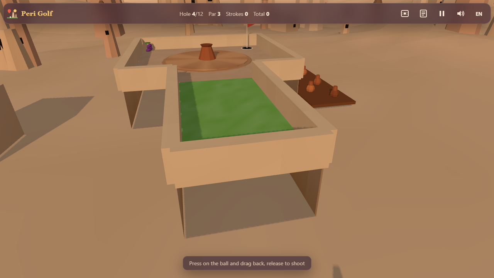<br><sub>Hole 4, procedural</sub></td>
    <td width="50%">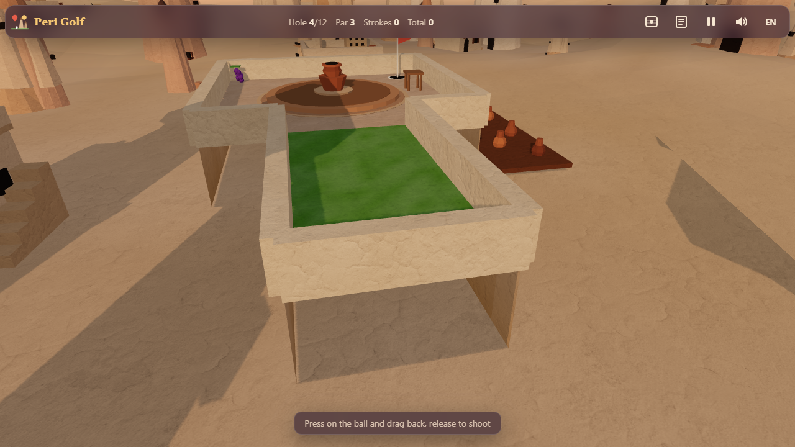<br><sub>Hole 4, with the asset pass</sub></td>
  </tr>
  <tr>
    <td width="50%">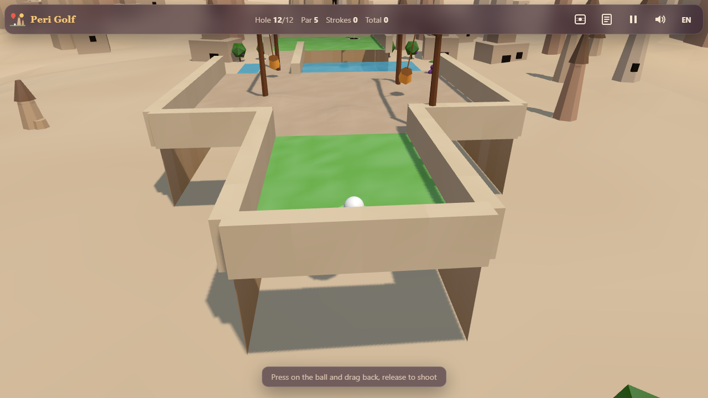<br><sub>Hole 12, procedural</sub></td>
    <td width="50%">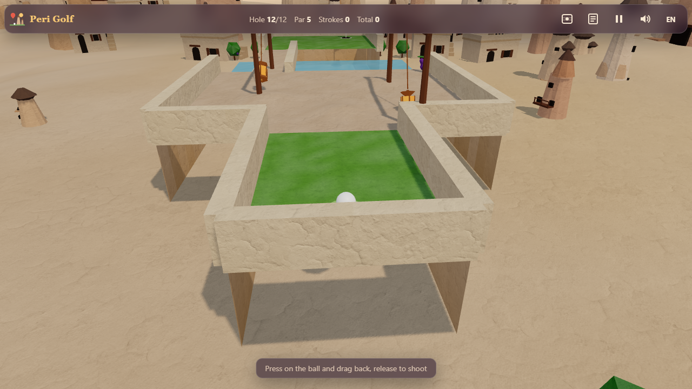<br><sub>Hole 12, with the asset pass</sub></td>
  </tr>
</table>

<p align="center">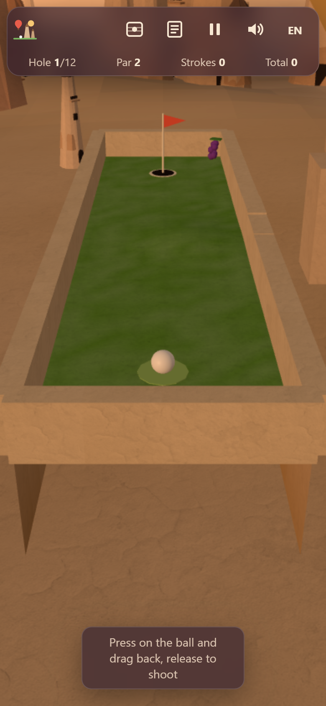<br><sub>On a phone (Low tier)</sub></p>

</details>

## Redesign & Performance

**Art direction:** Fantasy miniature diorama. Pastel tuff `#E8C9A0`, rose rock `#C98B7A`, moss `#7FA36B`, sky `#9AD1F5`, and flag red `#E53935`, lit like a toy under a soft morning sun with tilt-shift depth fog.

**Visual updates (physics, controls, scoring, 12 holes, bot, saves and both languages are untouched):**
- **Palette and lighting:** Pastel vertex colours, warm sun plus a sky-tinted hemisphere, nearer fog so the far chimneys fade like a model landscape, and a lighter procedural sky with clouds.
- **Environment:** Diorama base around every hole (moss and grass patches with dark rims, a pebble path that rings the course and runs back to the tee, instanced tuff boulders, toadstool clusters, and pebbles), course terrace as layered tuff strata with a mossy lip and contact shadow, hero fairy chimneys at hole scale past the cup, rounded rock arches with mossy crowns over tunnels and cave houses, tiny wooden bridges with railings over water, drifting fairy-light motes, and a flatter tee camera.
- **Objects:** Toy-like props (round bushes with blossoms, flower patches, signposts beside every tee showing hole number and par on painted boards), pop-in animation on hole load, sparkle ball trail, and pastel splash and cup FX.
- **UI skin:** Wooden signpost boards with a cream face for every panel (title, hole card, pause, settings, hole result, scorecard, course complete), pastel toy buttons with a 3D edge, Fredoka as the self-hosted UI face (`assets/fonts/`), 44 px touch targets, visible focus rings, and phone portrait/landscape layouts.

**Measured on an Intel UHD 620 (headless Chrome, 1280x720, High tier, with assets):**

| Measurement | v1 (2026-10) | Redesign (2026-11) |
|---|---|---|
| Title fps / draw calls | 60 / 16 | 60 / 18 |
| Hole 4 fps / draw calls | 56 / 19 | 58–60 / 26 |
| Hole 12 fps / draw calls | 60 / 20 | 60 / 27 |
| Hole 7 and hole 9 | — | 60 / 27 and 60 / 25 |
| Phone 500x900 (Low tier) | — | 60 / 26 |
| `?low` on desktop, `?noassets` | — | 60 / 25, 60 / 18 |
| `?auto` bot, 12 holes | 18 strokes, 0 errors | 14 strokes, 20 stars, 0 errors (with assets and `?noassets`; re-measured 2026-11-09, bot uses 8 hidden shortcuts) |

The `?auto` bot plays all 12 holes with the same physics as a player: 14 strokes (card 1,1,1,1,1,1,1,1,1,1,2,2), 20 stars and 0 errors, identical scorecard with and without optional assets. It finds and takes the hidden shortcut on 8 holes, which is why it beats par 40 by so much (earlier asset-pass measurements, 18 strokes: [docs/assets.md](docs/assets.md#measurements-intel-uhd-620-headless-chrome-1280x720-high-tier)).

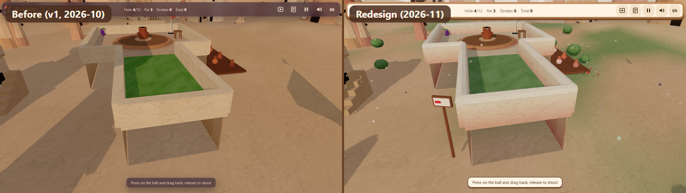

## Running locally

Serve the folder over HTTP (ES modules do not load from `file://`):

```bash
python -m http.server 8000
```

Then open <http://localhost:8000/>.

## Made with Claude Code

Built by **Claude Fable 5.1** with Claude Code from one prompt: [prompts/peri-golf.md](prompts/peri-golf.md). The base game is fully procedural: every mesh is built in code with vertex colours (static geometry merged into one draw call per course and one for scenery, instanced balloons and pigeons), and every sound is synthesised with the Web Audio API.

### Asset pass

An optional asset pass (671 KB) adds Poly Haven detail textures for tuff, grass, and sand, a dawn HDRI for High-tier lighting, eight Blender-built low-poly models (three fairy chimneys, a cave house, a balloon, the pottery wheel, the donkey, and a lantern), and Kenney one-shot sounds. They load after the first frame and procedural versions stay as fallback (`?noassets` skips them). Licences: [CREDITS.md](CREDITS.md); file list, sizes, and before/after numbers: [docs/assets.md](docs/assets.md). Model scripts: `assets/src/`.

<details>
<summary><b>Technical notes</b></summary>

- **Procedural base:** Every mesh is constructed in code with vertex colours. Static geometry is merged into one draw call per course and one for background scenery, with instanced meshes for balloons and pigeons.
- **Lighting & materials:** Low tier uses `MeshLambertMaterial`; High tier uses `MeshStandardMaterial` with ACES filmic tone mapping and PMREM environment derived from the dawn HDRI.
- **Physics simulation:** Slopes, bumps, ramps, jumps, and wall bounces with coefficient of restitution, with distinct friction parameters across grass, sand, and stone pads.
- **Dynamic obstacles:** Turning pottery wheel (radius 0.32 m matching collision geometry), rolling stone door, swinging lanterns (1.28 m pivot chain), and walking donkey with hinged hip joints.

</details>

### Claude Game Arena

Peri Golf is part of the **Claude Game Arena** series, where each game is built by a Claude model from one prompt.

[Hisar](https://furkiozknn.github.io/kale-savunmasi/) · [Çay Ocağı](https://furkiozknn.github.io/cay-ocagi/) · [Çini Ustası](https://furkiozknn.github.io/cini-ustasi/) · [Martı](https://furkiozknn.github.io/marti/) · [Kervan](https://furkiozknn.github.io/kervan/) · [Dolmuş](https://furkiozknn.github.io/dolmus/) · [Mehter](https://furkiozknn.github.io/mehter/) · [Boğaz Vapuru](https://furkiozknn.github.io/bogaz-vapuru/) · [Simit Fırını](https://furkiozknn.github.io/simit-firini/) · [Karagöz](https://furkiozknn.github.io/karagoz/) · [Lale Bahçesi](https://furkiozknn.github.io/lale-bahcesi/)

**Round 5:** [Kapadokya Balonu](https://furkiozknn.github.io/kapadokya-balonu/) · [Ebru](https://furkiozknn.github.io/ebru/) · [Kırkpınar](https://furkiozknn.github.io/kirkpinar/) · [Çarşı Kaçışı](https://furkiozknn.github.io/carsi-kacisi/)

**Round 6:** [Topkapı Gecesi](https://furkiozknn.github.io/topkapi-gecesi/) · [Hamsi](https://furkiozknn.github.io/hamsi/) · [Pamukkale](https://furkiozknn.github.io/pamukkale/) · [Mimar Sinan](https://furkiozknn.github.io/mimar-sinan/)

## License

MIT, see [LICENSE](LICENSE). Third-party assets are CC0, see [CREDITS.md](CREDITS.md).

Like the game? You can support new rounds on [Buy Me a Coffee](https://buymeacoffee.com/furkiozkann). The game stays free.
