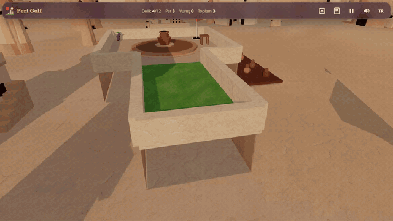
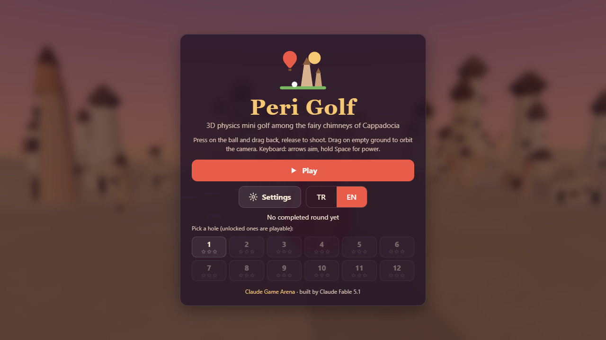
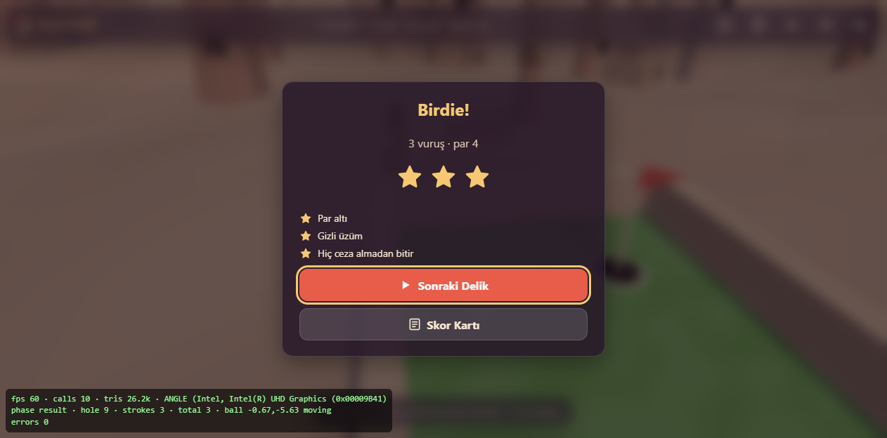
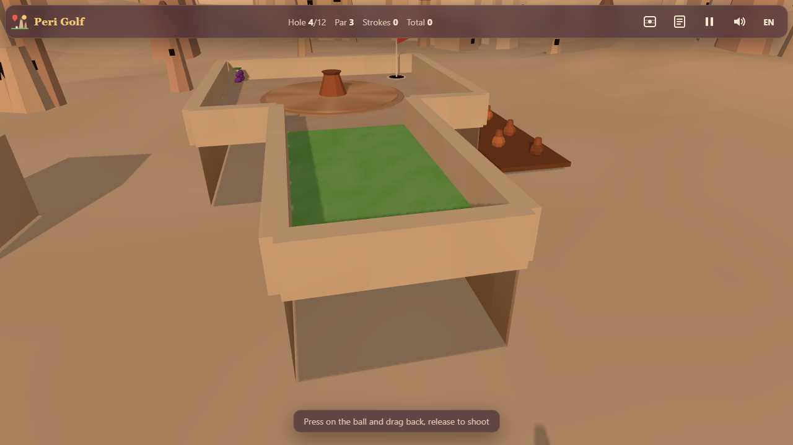
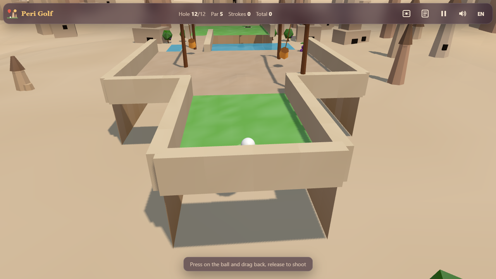

<p align="center">
  <a href="https://furkiozknn.github.io/peri-golf/"></a>
</p>

<p align="center">
  <a href="https://furkiozknn.github.io/peri-golf/"></a>
  
  
  <a href="LICENSE"></a>
  
</p>

<p align="center"><b>A 3D physics mini-golf game set among the fairy chimneys of Cappadocia: 12 hand-designed holes past cave houses, a pottery wheel, a donkey crossing and a sunrise rim with hot-air balloons overhead.</b></p>

<p align="center">
  
  <br>
  <sub>Watch the promo: <a href="https://github.com/Furkiozknn/social-videos/releases/download/promo-2026-10/2026-10-27-peri-golf-en.mp4">EN</a> · <a href="https://github.com/Furkiozknn/social-videos/releases/download/promo-2026-10/2026-10-27-peri-golf-tr.mp4">TR</a></sub>
</p>

<p align="center"><b>Play online: <a href="https://furkiozknn.github.io/peri-golf/">https://furkiozknn.github.io/peri-golf/</a></b> (desktop and phone, no install)</p>

<!-- portals:start -->
<p align="center">Also on: <a href="https://furkiozknn.itch.io/peri-golf">itch.io</a></p>
<!-- portals:end -->

## Highlights

- **Twelve holes, par 40.** From Pigeon Terrace to Sunrise Ridge: terraces between fairy chimneys, cave houses, an
  underground-city tunnel, a pottery workshop, a vineyard road, a stone bridge and a pigeon valley.
- **Real rolling physics.** Slopes, bumps, ramps and jumps, wall bounces with restitution, and different friction on
  grass, sand and stone.
- **Things that move.** A turning pottery wheel, a rolling stone door, swinging lanterns and a donkey crossing the path
  all push the ball.
- **Three stars per hole.** Finish under par, find the hidden grape and land the hole's trick shot (a hole in one, a
  bank off a wall, a long putt); a ghost line shows your best shot.
- **Played by a bot.** The `?auto` bot uses the same physics as a player and finishes all 12 holes in 18 strokes with
  0 errors, with or without the optional assets.
- **Light on a laptop GPU.** 60 fps on an Intel UHD 620 at 1280x720 with 16-22 draw calls on the High tier, and a Low
  tier for phones ([measurements](docs/assets.md)).
- **One file, made in code.** One `index.html` with Three.js r170 from a CDN; every mesh is built in code and every
  sound is synthesised, with an optional CC0 asset pass loaded on top.

## How to play

> [!TIP]
> **Goal:** sink the ball on all 12 holes in as few strokes as you can. The course par is 40; holes unlock one by one.

Press on the ball, drag back and release. The white line previews the shot up to the first bounce. Drag on empty
ground to orbit the camera, and use the eye button (or `V`) for a top-down overview of the hole.

<details>
<summary><b>More rules</b></summary>

- Water hazards and falls off the course cost one stroke and put the ball back.
- Moving obstacles push the ball: the pottery wheel, the rolling stone door, the swinging lanterns and the donkey.
- Each hole has a par and three challenge stars: under par, a hidden grape to collect, and a hole-specific trick shot.
- A ghost line shows your best completion of each hole.
- The scorecard (`C`) shows strokes against par for every hole.

</details>

### Controls

| Action | Mouse / touch | Keyboard |
|---|---|---|
| Aim and shoot | press on the ball, drag back, release | `Left` / `Right` aim, hold `Space` to charge, release to shoot |
| Orbit the camera | drag on empty ground | |
| Zoom | wheel | `Up` / `Down` |
| Top-down overview | eye button | `V` |
| Scorecard | scorecard button | `C` |
| Pause menu | pause button | `P` / `Esc` |
| Music / effects / language | settings | `M` / `X` / `L` |

Settings (master, music and effects volume, TR / EN, Low / High quality) are saved in `localStorage` under
`arena.periGolf.settings`; the run under `arena.periGolf.save`; the best card, unlocks, hole records and ghost lines
under `arena.periGolf.best`. The language follows the browser; phones start on the Low tier.

<details>
<summary><b>URL flags for testing</b></summary>

| Flag | Effect |
|---|---|
| `?auto` | a bot plays the whole course with the same physics as a player |
| `?debug` | fps, draw calls, triangles, GPU name and JS errors on screen; `window.periGolfSim(seconds)` and `window.periGolfDebug` |
| `?sim=N` | fast-forward N seconds of simulation before the first frame |
| `?low` | shadows off, pixel ratio 1, half the particles |
| `?noassets` | skip the optional assets in `assets/` and play the procedural version |
| `?lang=en` / `?lang=tr` | language |
| `?hole=N` | start a run at hole N (1-12) |
| `?nosave` | do not write to `localStorage` |

The live state is on `window.periGolf`.

</details>

## Screenshots

<table>
  <tr>
    <td width="33%"><br><sub>Title screen</sub></td>
    <td width="33%"><br><sub>Hole 4: Pottery Workshop</sub></td>
    <td width="33%"><br><sub>Hole 8: the donkey crossing</sub></td>
  </tr>
  <tr>
    <td><br><sub>Hole 2: Chimney Bend</sub></td>
    <td><br><sub>Hole 12: Sunrise Ridge</sub></td>
    <td><br><sub>Birdie and three stars (Turkish UI)</sub></td>
  </tr>
</table>

<details>
<summary><b>Phone layout and the asset pass, before and after</b></summary>

<table>
  <tr>
    <td width="50%"><br><sub>Hole 4, procedural</sub></td>
    <td width="50%"><br><sub>Hole 4, with the asset pass</sub></td>
  </tr>
  <tr>
    <td><br><sub>Hole 12, procedural</sub></td>
    <td><br><sub>Hole 12, with the asset pass</sub></td>
  </tr>
</table>

<p align="center"><br><sub>On a phone (Low tier)</sub></p>

</details>

## Balance

The `?auto` bot plays all 12 holes with the same physics as a player: 18 strokes and 0 errors, the same card with and
without the optional assets ([measurements](docs/assets.md#measurements-intel-uhd-620-headless-chrome-1280x720-high-tier)).

## Running locally

Serve the folder over HTTP (ES modules do not load from `file://`):

```
python -m http.server 8000
```

then open <http://localhost:8000/>.

## How it was made

Built by **Claude Fable 5.1** with Claude Code from one prompt: [prompts/peri-golf.md](prompts/peri-golf.md). The base
game is fully procedural: every mesh is built in code with vertex colours (static geometry merged into one draw call per
course and one for the scenery, instanced balloons and pigeons), and every sound is synthesised with the Web Audio API.

An optional asset pass (671 KB) adds Poly Haven detail textures for tuff, grass and sand, a dawn HDRI for the High-tier
lighting, eight Blender-built low-poly models (three fairy chimneys, a cave house, a balloon, the pottery wheel, the
donkey and a lantern) and Kenney one-shot sounds. They load after the first frame and the procedural versions stay as
the fallback (`?noassets` skips them). Licences: [CREDITS.md](CREDITS.md); file list, sizes and before/after numbers:
[docs/assets.md](docs/assets.md). Model scripts: `assets/src/`.

Peri Golf is part of the **Claude Game Arena** series, where each game is built by a Claude model from one prompt. The
other games: [Hisar](https://furkiozknn.github.io/kale-savunmasi/) ·
[Çay Ocağı](https://furkiozknn.github.io/cay-ocagi/) · [Çini Ustası](https://furkiozknn.github.io/cini-ustasi/) ·
[Martı](https://furkiozknn.github.io/marti/) · [Kervan](https://furkiozknn.github.io/kervan/) ·
[Dolmuş](https://furkiozknn.github.io/dolmus/) · [Mehter](https://furkiozknn.github.io/mehter/) ·
[Boğaz Vapuru](https://furkiozknn.github.io/bogaz-vapuru/) · [Simit Fırını](https://furkiozknn.github.io/simit-firini/)
· [Karagöz](https://furkiozknn.github.io/karagoz/) · [Lale Bahçesi](https://furkiozknn.github.io/lale-bahcesi/)

**Round 5:** [Kapadokya Balonu](https://furkiozknn.github.io/kapadokya-balonu/) ·
[Ebru](https://furkiozknn.github.io/ebru/) · [Kırkpınar](https://furkiozknn.github.io/kirkpinar/) ·
[Çarşı Kaçışı](https://furkiozknn.github.io/carsi-kacisi/)

**Round 6:** [Topkapı Gecesi](https://furkiozknn.github.io/topkapi-gecesi/) ·
[Hamsi](https://furkiozknn.github.io/hamsi/) · [Pamukkale](https://furkiozknn.github.io/pamukkale/) ·
[Mimar Sinan](https://furkiozknn.github.io/mimar-sinan/)

## Türkçe

**Peri Golf**, Kapadokya'nın peribacaları arasında geçen gerçek fizikli 3D mini golf oyunu. Mağara evler, dönen çömlek
tezgâhı, yoldan geçen eşek ve sıcak hava balonlarının süzüldüğü gün doğumu sırtı arasında 12 delik seni bekliyor; par
altında bitir, gizli üzümü bul, deliğin numarasını yap. Kurulum yok; masaüstünde ve telefonda tarayıcıda oynanır. Claude
Fable 5.1 tarafından Claude Code ile tek bir prompt'tan yapıldı.

**Oyna:** https://furkiozknn.github.io/peri-golf/

## License

MIT, see [LICENSE](LICENSE). Third-party assets are CC0, see [CREDITS.md](CREDITS.md).

Like the game? You can support new rounds on [Buy Me a Coffee](https://buymeacoffee.com/furkiozkann). The game stays free.
