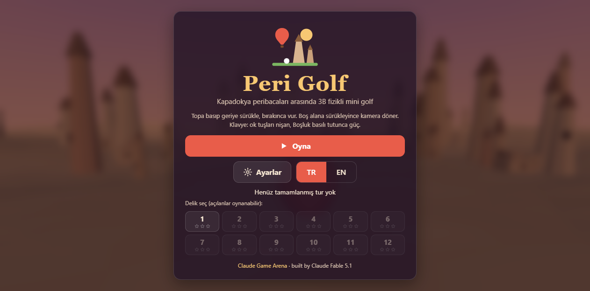
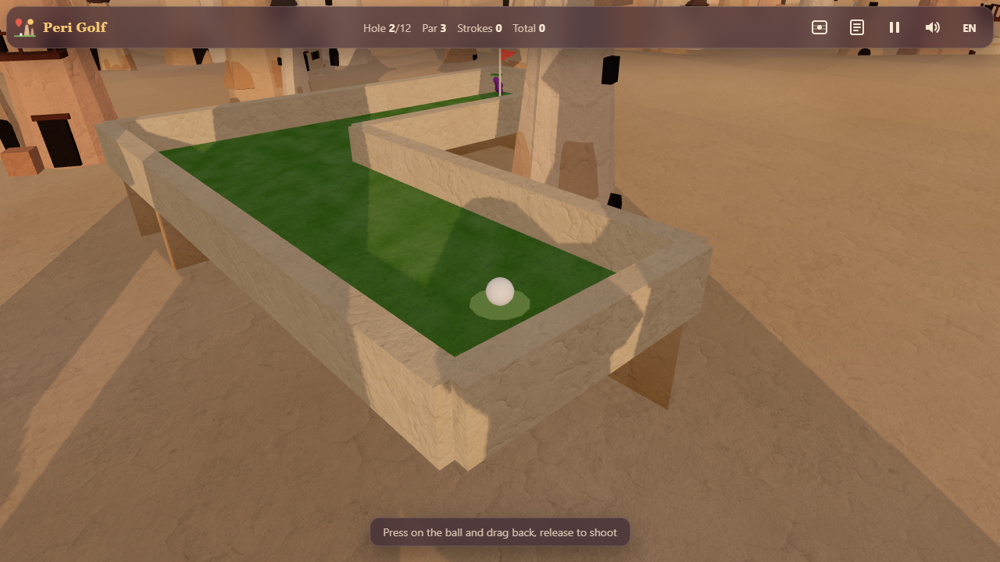
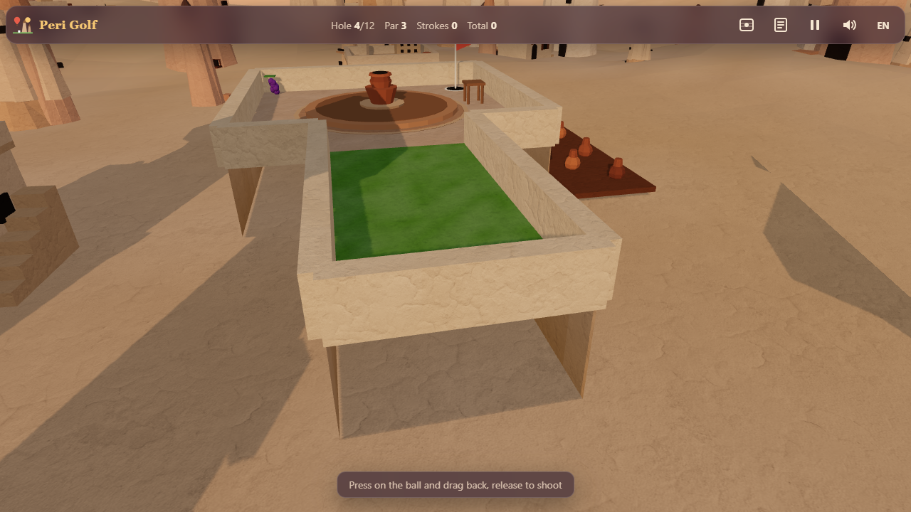
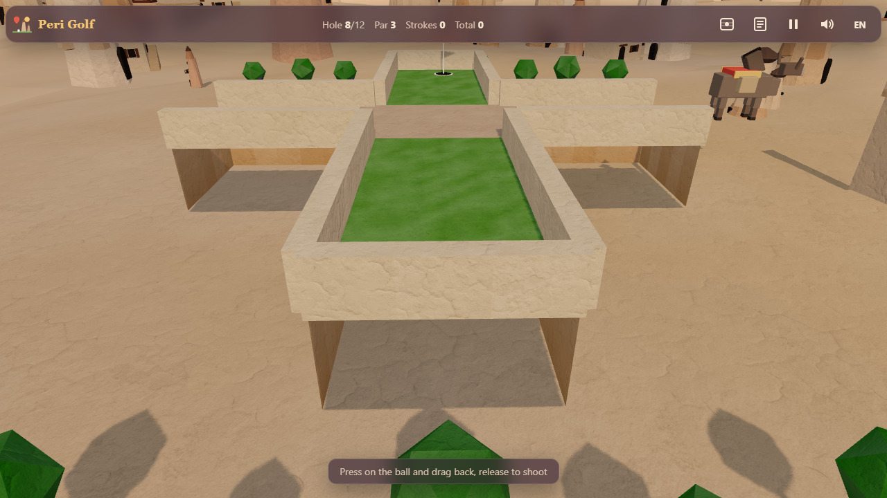
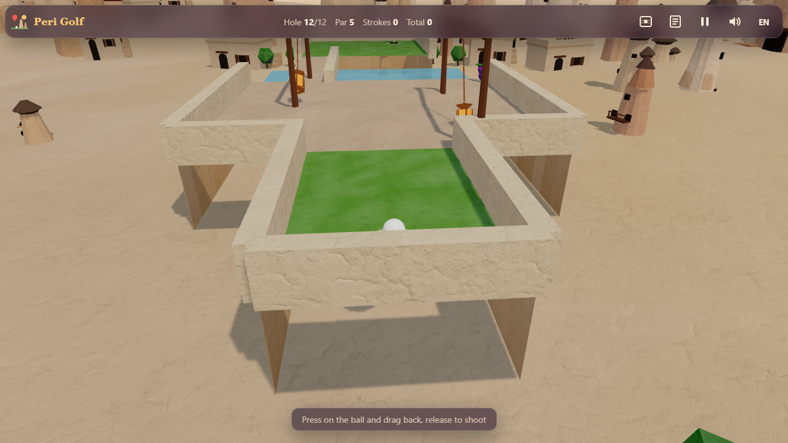
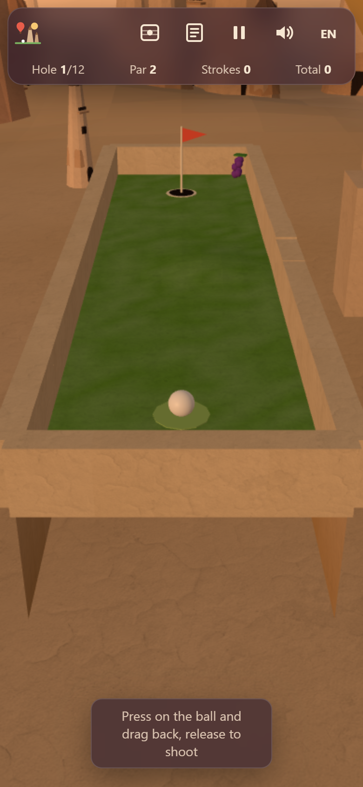

# Peri Golf

**Play online:** https://furkiozknn.github.io/peri-golf/ (desktop and phone, no install)

A 3D physics mini-golf game set among the fairy chimneys of Cappadocia: 12 hand-designed holes on terraces between
chimneys, cave houses, a pigeon valley, an underground-city tunnel, a pottery workshop, a vineyard and a sunrise rim with
hot-air balloons drifting overhead. One `index.html`, Three.js r170 from a CDN, no build step. Every mesh is built in code with vertex colours and every
sound is synthesised with Web Audio; a small set of optional CC0 assets (detail textures, an HDRI, Blender-built models,
real one-shot sounds) is layered on top when it can load.

Part of the **Claude Game Arena** (round 3).

## Screenshots

| | |
|---|---|
|  |  |
|  |  |
|  |  |

## Play

Serve the folder over http (ES modules do not load from `file://`):

```
python -m http.server 8000
# then open http://localhost:8000/
```

Works on desktop and phones (portrait and landscape) with mouse, touch and keyboard.

## How to play

- **Aim and shoot:** press on the ball, drag back, release. The white line previews the shot up to the first bounce.
- **Camera:** drag on empty ground to orbit, mouse wheel to zoom, `V` or the eye button for a top-down overview.
- **Keyboard:** arrows aim (up/down zoom), hold `Space` to charge power, release to shoot.
- `P` / `Esc` pause, `M` music, `X` effects, `L` language, `C` scorecard, `Enter`/`Space` on buttons.

Rules: real rolling physics (slopes, bumps, ramps and jumps, wall bounces with restitution, grass / sand / stone
friction), water hazards and falls off the course cost one stroke and reset the ball, moving obstacles push it
(a turning pottery wheel, a rolling stone door, swinging lanterns, a donkey crossing the path). Each hole has a par,
three challenge stars (under par, a hidden grape to collect, a hole-specific trick shot) and a ghost line of your best
completion. Holes unlock one by one; the best card and the current run are saved in `localStorage`.

## Flags

| Flag | Effect |
|---|---|
| `?auto` | A bot plays the whole course with the same physics as a player |
| `?debug` | fps, draw calls, triangles, GPU name and JS errors on screen; exposes `window.periGolfSim(seconds)` and `window.periGolfDebug` |
| `?sim=N` | Fast-forward N seconds of simulation before the first frame |
| `?low` | Low quality: shadows off, pixel ratio 1, half the particles |
| `?noassets` | Skip the optional assets in `assets/` and play the procedural version |
| `?lang=en` / `?lang=tr` | Force the language |
| `?hole=N` | Start a run at hole N (1-12) |
| `?nosave` | Do not write to `localStorage` |

Live state is on `window.periGolf`. Settings are saved under `arena.periGolf.settings`, the run under
`arena.periGolf.save`, the best card, unlocks, hole records and ghost lines under `arena.periGolf.best`.

## Performance

Targets 60 fps on an Intel UHD 620 at 1280x720: pixel ratio capped at 1.5, one directional light with a 1024 shadow map
that covers only the active hole, merged static geometry with vertex colours (one draw call per course, one for the
scenery), InstancedMesh balloons and pigeons, particles as soft-sprite Points, no post-processing. Measured in headless
Chrome on the real Intel UHD GPU: 60 fps, 16-22 draw calls with the optional assets (12-15 without), about 70k
triangles with the instanced far field (27-31k without).

## Assets

`assets/` holds about 671 KB of optional CC0 material: grey detail textures for tuff, grass and sand, a 512 px
dawn HDRI for the High-tier environment light, eight low-poly Blender models (fairy chimneys, cave house, balloon,
pottery wheel, donkey, lantern; scripts in `assets/src/`) and six Kenney one-shots. They load after the first
frame; without them the game shows its procedural geometry and synthesised sounds. Sources and licences are in
[`CREDITS.md`](CREDITS.md), the full table with sizes, triangle counts and before/after numbers in
[`docs/assets.md`](docs/assets.md).

## How it was made

Built by Claude Fable 5.1 with Claude Code from one prompt: `prompts/peri-golf.md`.

## License

MIT, see `LICENSE`.
